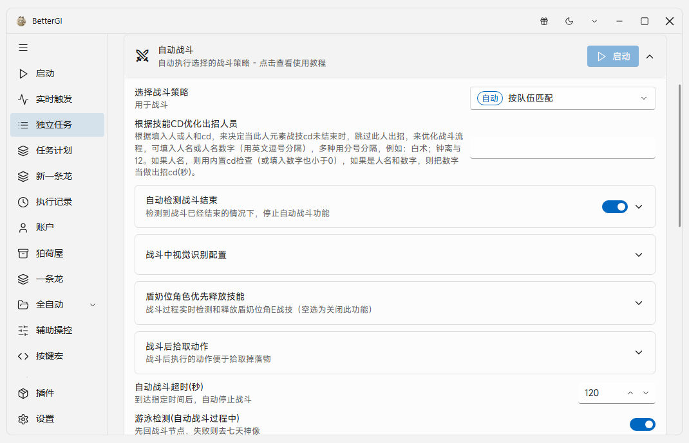

# BetterGI UI

以 BetterGI 原版 WPF 为参考的 Web UI。交互组件和组合页面都可以在 Moduloom 里预览。

## 快速开始

需要 Node.js 22.18+ 和 pnpm 11。

~~~sh
git clone --recurse-submodules https://github.com/Moduloom/bettergi-ui.git
cd bettergi-ui
pnpm install --frozen-lockfile
pnpm dev
~~~

打开 [127.0.0.1:4321](http://127.0.0.1:4321/)，选择「组合 → 全部」。Windows 预览可读取系统主题色。运行 pnpm build 可构建独立 Web 界面。

本项目提供 Web 界面预览，游戏功能依赖本机 BetterGI。

[原版 BetterGI](https://github.com/babalae/better-genshin-impact) · [Moduloom](https://github.com/Moduloom/moduloom) · [GPL v3](LICENSE) · [第三方素材](THIRD_PARTY.md)
